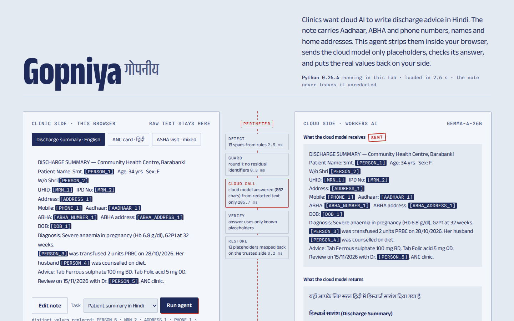

# Gopniya (गोपनीय) — keep patient identifiers out of cloud AI

**Live demo: https://gopniya.pages.dev** · MIT licence · Code for a Billion 2026, Health track

Gopniya is a small agent that sits between a clinic and any cloud language model. It finds
Aadhaar numbers, ABHA numbers and addresses, PAN, phone numbers, e-mails, hospital IDs, dates
of birth, names and home addresses in clinical notes written in English, Hindi or Hinglish,
replaces them with typed placeholders such as `[PERSON_1]` or `[AADHAAR_1]`, sends only the
placeholder version to the cloud model, checks the answer, and puts the real values back on
the clinic's side.

In the live demo the redaction engine is Python running inside the visitor's browser
(Pyodide). The raw note never leaves the tab; only the redacted note is posted to the model.



## Why

- India has issued 93.95 crore ABHA (Ayushman Bharat Health Account) numbers and linked
  over 105 crore digital health records as of 10 July 2026
  ([GKToday, Mission Steering Group update](https://www.gktoday.in/ayushman-bharat-digital-mission-crosses-93-95-crore-health-accounts/)).
  Clinical text in India is increasingly tied to a national identifier.
- Clinics and health programmes want cloud models for discharge advice in Hindi, referral
  letters, and summaries for ASHA workers. Pasting a note into a cloud chatbot sends the
  patient's Aadhaar, ABHA, phone number and home address to a third party.
- Under the Digital Personal Data Protection Act, 2023, failing to take reasonable security
  safeguards to prevent a personal data breach can draw a penalty of up to ₹250 crore
  (Schedule, item 1; [text of the Schedule](https://dpdpa.com/theschedule.html)).
- Health systems are targets: the AIIMS Delhi e-hospital servers went down in a ransomware
  attack on 23 November 2022 and the hospital ran manually for days
  ([Healthcare IT News](https://www.healthcareitnews.com/news/asia/aiims-delhi-turns-manual-following-ransomware-attack)).

## How the agent works

```
note ─► detect (rules, optional local LLM-NER) ─► replace with placeholders
     ─► guard: independent re-scan of the redacted text
          └─ residual identifier? map it back, redact, re-scan (max 3 rounds) ─► still leaking? BLOCK, send nothing
     ─► cloud model receives the redacted note only
     ─► verify: placeholders in the answer must exist in the note; no new ID-like numbers
          └─ problem? one corrective retry with feedback
     ─► restore real values locally ─► answer for the clinician
```

| Step | What it does |
|---|---|
| detect | Aadhaar (12 digits, first digit 2–9, Verhoeff check digit, or any 12 digits next to an "Aadhaar/आधार" label, masked forms too); ABHA number (XX-XXXX-XXXX-XXXX or labelled); ABHA address (`…@abdm`, `@sbx`); PAN (holder-type letter checked); EPIC voter ID; Indian mobiles and labelled landlines; e-mail; UHID/MRN/IPD/OPD/CR numbers; DOB; PIN codes; names from honorifics (Mr., Smt., Shri, Dr., श्री, श्रीमती, डॉ.), field labels (Patient Name, रोगी का नाम, ASHA), relation markers (S/o, W/o, पुत्र, पत्नी) and kinship words (husband, beti, भाई); addresses from labels (Address, R/o, पता, निवासी) and starts (Village, H. No., ग्राम). Devanagari digits are normalised first. |
| propagate | Every detected name, and each part of it, is redacted everywhere else in the note ("Smt. Sunita Devi … Sunita was advised"). |
| local NER (optional) | A model on the same machine (Ollama) proposes extra names and addresses. The agent refuses an NER backend that is not local, because NER sees raw text. |
| guard | Re-reads the redacted text with looser checks: known values still present, runs of 8+ digits, honorific followed by a word, e-mail-like strings. Findings are mapped back to the original note and redacted. |
| verify | Rejects placeholders the model invented and identifier-shaped numbers in the answer, then asks for one fix. |
| restore | Replaces placeholders with the original values; tolerant of `[[PERSON_1]]`, `PERSON_1`, `[PERSON 1]`. |

There is deliberately no dictionary of Indian names: it would inflate scores on synthetic data
built from similar lists and miss real names anyway.

## Measured results

RESULTS_PLACEHOLDER

## Run it

```bash
pip install -e ".[dev]"     # no runtime dependencies, standard library only
pytest                      # 20+ unit tests

# redact only; nothing leaves the machine
python -m gopniya redact examples/discharge_en.txt

# full agent with the public demo endpoint (redacted text only is sent)
python -m gopniya run examples/discharge_en.txt --task summary_hi --llm endpoint:https://gopniya.pages.dev/api/llm

# fully offline: local model for NER and for the answer
python -m gopniya run examples/anc_hi.txt --llm ollama:qwen2.5:7b-instruct --ner ollama:qwen2.5:7b-instruct

# reproduce the evaluation
python data/make_heldout.py && python eval/run_eval.py data/heldout.jsonl
python eval/run_eval.py data/heldout.jsonl --ner ollama:qwen2.5:7b-instruct
```

Tasks: `summary_en`, `summary_hi`, `referral`, `extract` (JSON), or any free-text instruction.

### Deploy the demo (Cloudflare Pages, free tier)

```bash
./scripts/build_web.sh                       # copies the browser-safe modules and metrics into web/
cd web && npx wrangler pages deploy . --project-name <name>
```

`web/wrangler.toml` binds Workers AI (`AI`) and a KV namespace (`DEMO_KV`). The function in
`web/functions/api/llm.js` re-checks every request for Aadhaar/ABHA/PAN/phone/e-mail patterns
and refuses it with HTTP 422 if any remain, caches answers by hash, and stops after 60 model
calls a day. Model: `@cf/google/gemma-4-26b-a4b-it` with thinking disabled.

## Repository map

| Path | What |
|---|---|
| `gopniya/detect.py` | rule passes, merge, name propagation |
| `gopniya/validators.py` | Verhoeff (Aadhaar), PAN, mobile, ABHA, PIN checks |
| `gopniya/vault.py` | reversible placeholders with referential consistency |
| `gopniya/guard.py` | leak scan on the redacted text |
| `gopniya/agent.py` | the loop: detect → guard → cloud → verify → restore |
| `gopniya/llm.py` | backends: demo endpoint, Workers AI, Ollama, Gemini CLI, local NER |
| `data/` | dev set (tuning) and held-out set (independent author) generators and data |
| `eval/` | evaluation script and saved results |
| `web/` | the demo page, Pyodide bridge, Pages Function |
| `video/` | 2–3 minute demo video with captions |

## Limits, stated plainly

- **No field deployment yet.** Every number above comes from synthetic, template-generated
  notes. Real notes have handwriting-OCR noise, local abbreviations and names in contexts no
  template covered. Treat the measurements as an upper bound until a clinic pilot measures
  recall on real, consented text.
- Names written with no cue at all (no honorific, label, relation or kinship word, and never
  mentioned with one elsewhere in the note) are missed by the rules. The optional local NER
  pass exists for these; its numbers are reported separately above.
- Ages, sex, admission and discharge dates, facility names, medicines and lab values are kept
  on purpose: the model needs them to write useful advice.
- Placeholders cost a little answer quality: the model cannot use the patient's name to pick
  Hindi gender forms, for example.

## Next steps

1. A pilot with one clinic or health programme: run the CLI on a sample of consented notes,
   have a person label leaks, publish recall per identifier type.
2. Marathi, Tamil, Bengali and Telugu cues; Urdu script.
3. A browser extension mode so a clinician can use any chatbot with the guard in front.

## Licence and credits

MIT. Detection, vault and merge ideas are adapted from RedactGate by the same authors.
All test data is synthetic; no real personal data is in this repository.
